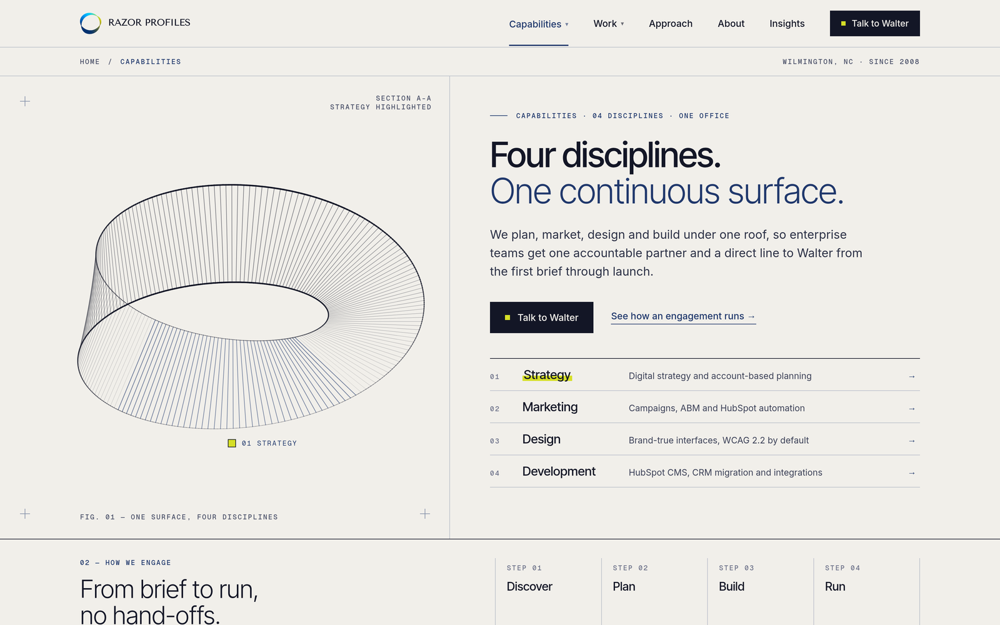
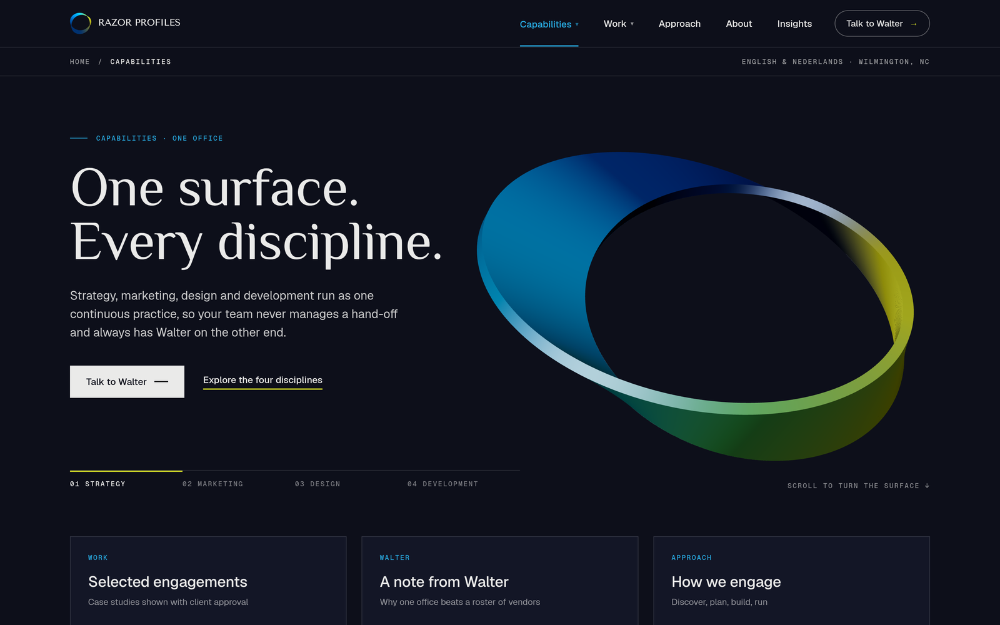
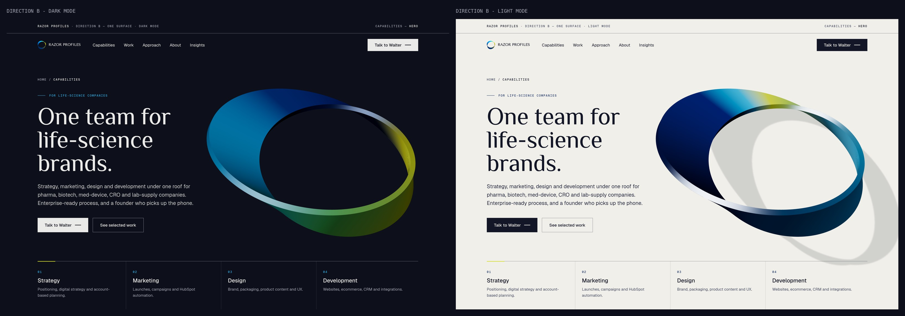
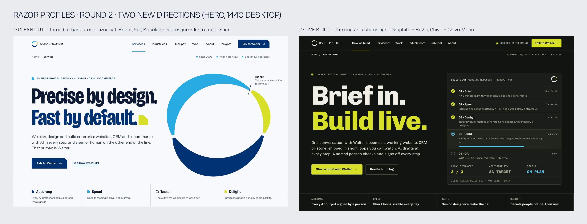
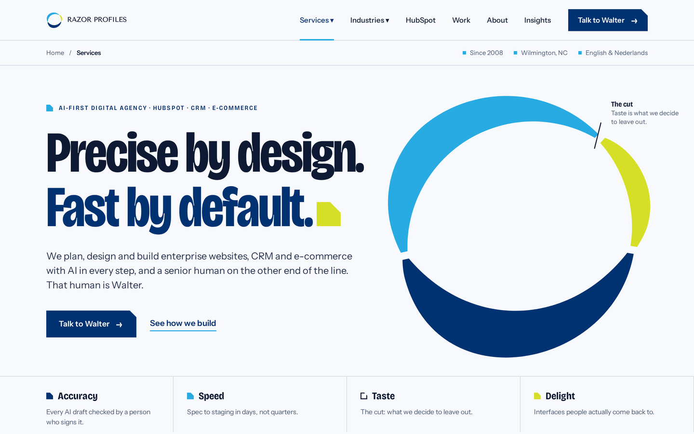
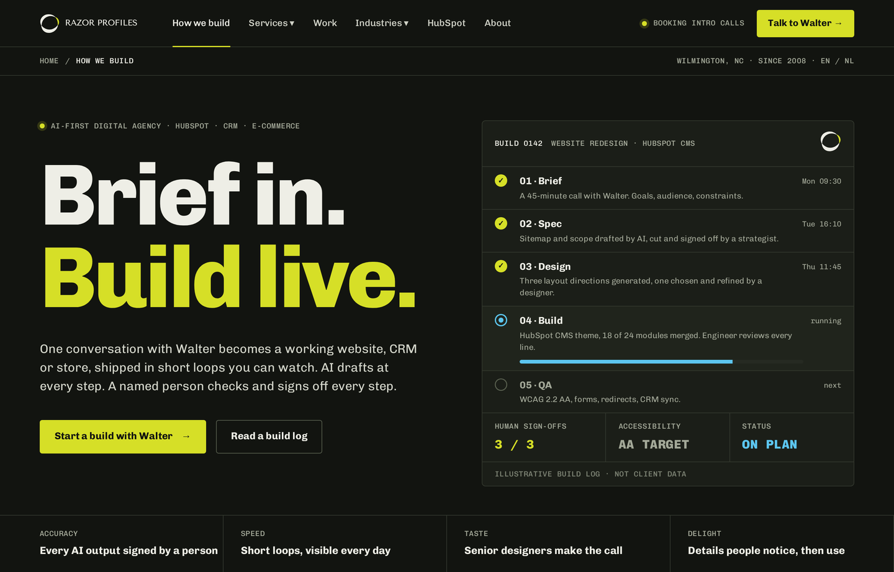

# Rio's Razor Profiles design proposals

Every direction Rio produced for the Razor Profiles site, with images and notes. The company name is Razor Profiles only.

These are comps and written considerations only. None of this has been merged, deployed, or published. Proposed headlines, testimonials, metrics, and calendar slots in the comps are sample copy unless a source document says otherwise.

The October 22 writeup is in [design-consideration.md](design-consideration.md). The November 12 round 2 notes are in [round-2/README.md](round-2/README.md).

## Round 1 — written October 22, 2026; comps around November 7, 2026

### Direction A: "Cross-Section"

A Swiss precision index: paper-first, with the work presented as a clean engineering cross-section. The hero uses a line-art Möbius. Headline in the hero comp: "Four disciplines. One continuous surface."

- Written brief: [design-consideration.md](design-consideration.md) (section "Direction A")
- Hero source: [comps/hero-A.html](comps/hero-A.html)
- Hero: [comps/hero-A-cross-section.png](comps/hero-A-cross-section.png) ([@2x](comps/hero-A-cross-section@2x.png))
- Module sheet: [comps/modules-A/sheet.jpg](comps/modules-A/sheet.jpg)
- Module source: [comps/modules-A/src/](comps/modules-A/src/)

Modules:

- [01 tabs](comps/modules-A/01-tabs.png)
- [02 media-text](comps/modules-A/02-media-text.png)
- [03 buttons](comps/modules-A/03-buttons.png)
- [04 accordion](comps/modules-A/04-accordion.png)
- [05 carousel](comps/modules-A/05-carousel.png)
- [06 cards](comps/modules-A/06-cards.png)
- [07 bento](comps/modules-A/07-bento.png)
- [08 quote](comps/modules-A/08-quote.png)
- [09 article](comps/modules-A/09-article.png)
- [10 CTA / footer](comps/modules-A/10-cta-footer.png)

### Direction B: "One Surface"

A dark, cinematic site. This is the direction that follows Walter's preferred Macro/Micro Möbius, with a 3D-capable strip as the hero. Headline in the hero comp: "One surface. Every discipline." As of mid-November 2026 Stuart preferred this direction; as of November 16 he still wanted all proposals in front of him before locking a choice. See [decisions.md](decisions.md).

- Written brief: [design-consideration.md](design-consideration.md) (section "Direction B")
- Hero source: [comps/hero-B.html](comps/hero-B.html)
- Hero: [comps/hero-B-one-surface.png](comps/hero-B-one-surface.png) ([@2x](comps/hero-B-one-surface@2x.png))
- Module sheet: [comps/modules-B/sheet.jpg](comps/modules-B/sheet.jpg)
- Module source: [comps/modules-B/src/](comps/modules-B/src/)

Modules:

- [01 tabs](comps/modules-B/01-tabs.png)
- [02 media-text](comps/modules-B/02-media-text.png)
- [03 buttons](comps/modules-B/03-buttons.png)
- [04 accordion](comps/modules-B/04-accordion.png)
- [05 carousel](comps/modules-B/05-carousel.png)
- [06 cards](comps/modules-B/06-cards.png)
- [07 bento](comps/modules-B/07-bento.png)
- [08 quote](comps/modules-B/08-quote.png)
- [09 article](comps/modules-B/09-article.png)
- [10 CTA / footer](comps/modules-B/10-cta-footer.png)

### Light-mode exploration

A light-mode and light-versus-dark study, filed with the November 7 comps. Direction B's brief already called for a light mode for long reads. The heroes are framed "For life-science companies."

- Dark hero: [comps/light/dark-hero.png](comps/light/dark-hero.png) ([@2x](comps/light/dark-hero@2x.png))
- Light hero: [comps/light/light-hero.png](comps/light/light-hero.png) ([@2x](comps/light/light-hero@2x.png))
- Light page: [comps/light/light-page.png](comps/light/light-page.png) ([@2x](comps/light/light-page@2x.png))
- Light vs dark: [comps/light/light-vs-dark.jpg](comps/light/light-vs-dark.jpg) ([@2x](comps/light/light-vs-dark@2x.jpg))
- Source: [comps/light/src/](comps/light/src/)

## Round 2 — November 12, 2026

Two further visual-identity directions. Rio's notes, rebuild steps, and caveats are in [round-2/README.md](round-2/README.md). Side-by-side heroes: [round-2/overview.jpg](round-2/overview.jpg). Shared render scripts: [round-2/shared/](round-2/shared/).

### Direction 1: "Clean Cut"

Headline in the hero comp: "Precise by design. Fast by default."

- Hero: [round-2/direction-1-clean-cut/hero.png](round-2/direction-1-clean-cut/hero.png) ([@2x](round-2/direction-1-clean-cut/hero@2x.png))
- Brand board: [round-2/direction-1-clean-cut/brand-board.png](round-2/direction-1-clean-cut/brand-board.png) ([@2x](round-2/direction-1-clean-cut/brand-board@2x.png))
- Module contact sheet: [round-2/direction-1-clean-cut/modules/contact-sheet.jpg](round-2/direction-1-clean-cut/modules/contact-sheet.jpg)
- Marks: [round-2/direction-1-clean-cut/mark/](round-2/direction-1-clean-cut/mark/)
- Source: [round-2/direction-1-clean-cut/src/](round-2/direction-1-clean-cut/src/)

Modules:

- [01 services grid](round-2/direction-1-clean-cut/modules/01-services-grid.png)
- [02 how we build](round-2/direction-1-clean-cut/modules/02-how-we-build.png)
- [03 tabs](round-2/direction-1-clean-cut/modules/03-tabs.png)
- [04 media-text](round-2/direction-1-clean-cut/modules/04-media-text.png)
- [05 case study](round-2/direction-1-clean-cut/modules/05-case-study.png)
- [06 meet Walter](round-2/direction-1-clean-cut/modules/06-meet-walter.png)
- [07 testimonial](round-2/direction-1-clean-cut/modules/07-testimonial.png)
- [08 engagement models](round-2/direction-1-clean-cut/modules/08-engagement-models.png)
- [09 FAQ accordion](round-2/direction-1-clean-cut/modules/09-faq-accordion.png)
- [10 CTA / footer](round-2/direction-1-clean-cut/modules/10-cta-footer.png)

### Direction 2: "Live Build"

Headline in the hero comp: "Brief in. Build live."

- Hero: [round-2/direction-2-live-build/hero.png](round-2/direction-2-live-build/hero.png) ([@2x](round-2/direction-2-live-build/hero@2x.png))
- Brand board: [round-2/direction-2-live-build/brand-board.png](round-2/direction-2-live-build/brand-board.png) ([@2x](round-2/direction-2-live-build/brand-board@2x.png))
- Module contact sheet: [round-2/direction-2-live-build/modules/contact-sheet.jpg](round-2/direction-2-live-build/modules/contact-sheet.jpg)
- Marks: [round-2/direction-2-live-build/mark/](round-2/direction-2-live-build/mark/)
- Source: [round-2/direction-2-live-build/src/](round-2/direction-2-live-build/src/)

Modules:

- [01 build log](round-2/direction-2-live-build/modules/01-build-log.png)
- [02 services index](round-2/direction-2-live-build/modules/02-services-index.png)
- [03 case study](round-2/direction-2-live-build/modules/03-case-study.png)
- [04 bento](round-2/direction-2-live-build/modules/04-bento.png)
- [05 media-text](round-2/direction-2-live-build/modules/05-media-text.png)
- [06 talk to Walter](round-2/direction-2-live-build/modules/06-talk-to-walter.png)
- [07 testimonials](round-2/direction-2-live-build/modules/07-testimonials.png)
- [08 engagement models](round-2/direction-2-live-build/modules/08-engagement-models.png)
- [09 insights carousel](round-2/direction-2-live-build/modules/09-insights-carousel.png)
- [10 CTA / footer](round-2/direction-2-live-build/modules/10-cta-footer.png)

## Supporting files (not separate directions)

- Logo downloads and renders: [logo/](logo/)
- Midjourney Möbius prompts: [mobius-mj/prompts.md](mobius-mj/prompts.md)
- Imagery notes, 1× sheets, Direction B context, and life-science composites: [imagery/](imagery/) (credits in [imagery/CREDITS.md](imagery/CREDITS.md))
- 2024 brand guidelines: [brand-guidelines-2024.pdf](brand-guidelines-2024.pdf)
- Source content (SOW, estimates, Zoom notes, sitemap, feedback thread): [content/](content/)
